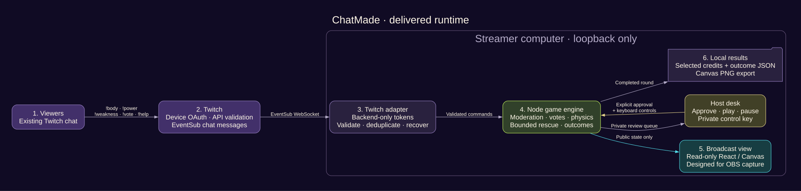
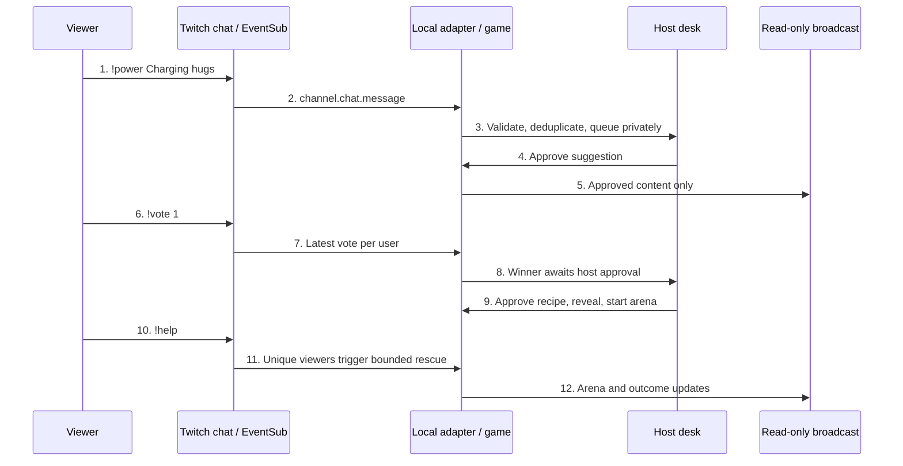

# Delivered architecture

This describes the current build, not the proposed runtime generation in ADR 0001. Codex helped build/test the application; there is no runtime model or multi-agent service.

## Components

| Component | Responsibility | Source |
| --- | --- | --- |
| Twitch adapter | Public device auth, token validation/refresh, EventSub subscription/recovery/deduplication | `server/twitch.ts` |
| Local server | Loopback HTTP/WebSocket, host authentication, origin checks, public/private snapshots, result persistence | `server/index.ts` |
| Game engine | Phase gates, moderation, seeded recipes, votes, physics, rescue and outcomes | `shared/game.ts` |
| Host desk | Setup, approvals, keyboard controls and export | `src/main.tsx`, `src/ConnectionPanel.tsx`, `src/arena.ts` |
| Broadcast view | Read-only rendering for an OBS Browser Source | `/broadcast` |
| Local files | Private launcher/key, public publisher configuration, selected round JSON | ignored `data/` |

## One interaction

Host controls require an authenticated local WebSocket. Broadcast clients receive no host-only moderation queue or device authorisation instructions. Access/refresh/device tokens stay backend-only. The game is authoritative at fixed simulation steps; the browser renders server snapshots. Round JSON saves selected credits and outcome rather than raw chat. Export PNG is generated locally by Canvas.

## Verification boundary

The 28-test suite covers deterministic gameplay and mocked service/protocol paths. A real one-account Twitch round additionally verified delivery through to PNG. Repeated idle keepalive timeouts remain open. Intended OBS capture, three-viewer usability and clean-machine onboarding still need observation. No FPS or latency result is claimed.
